# Veyra: 3D Product Pages

Interactive, scroll-driven 3D product pages for **Veyra**, a concept audio brand with five products:

- **Veyra One** (`/`): wireless over-ear headphones
- **Veyra Buds** (`/buds`): wireless earbuds in a charging case
- **Veyra Arc** (`/arc`): a portable 360° speaker
- **Veyra Halo** (`/halo`): a smart home speaker with a glowing light ring
- **Veyra Spin** (`/spin`): a belt-driven turntable

Every product is modelled entirely in code with Three.js. Each one turns, opens up and changes finish as you scroll, and has a listening demo built with the Web Audio API.

> Veyra is a fictional brand created for this project. The product, specs and prices are illustrative.

**Live demo:** [veyra-3d-alpha.vercel.app](https://veyra-3d-alpha.vercel.app)

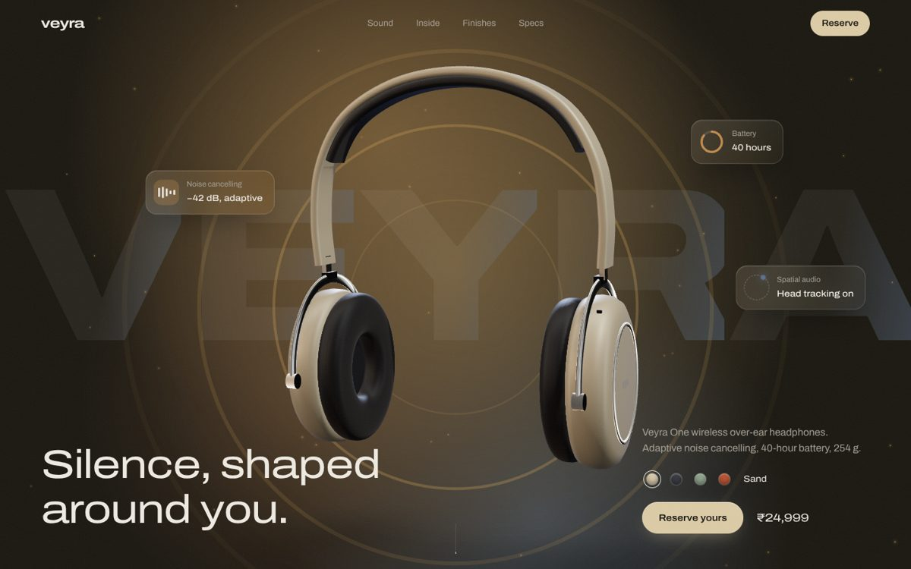

| Veyra Buds | Veyra Arc |
|---|---|
| 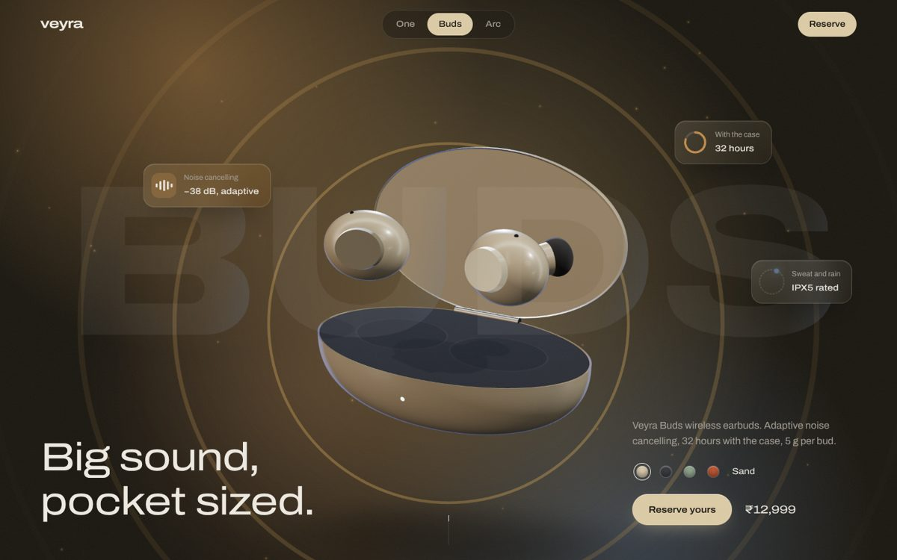 | 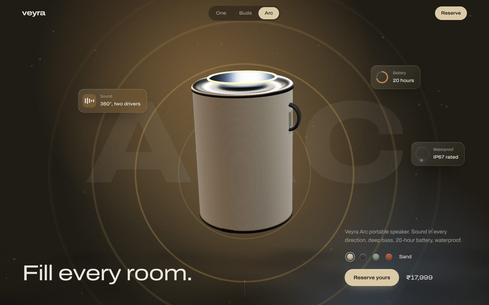 |

| Veyra Halo | Veyra Spin |
|---|---|
| 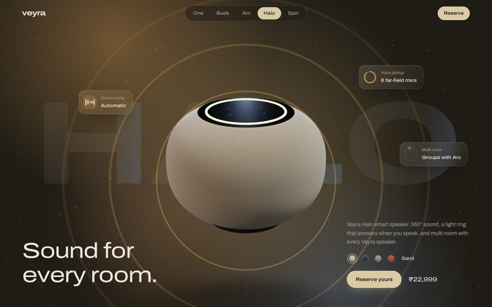 | 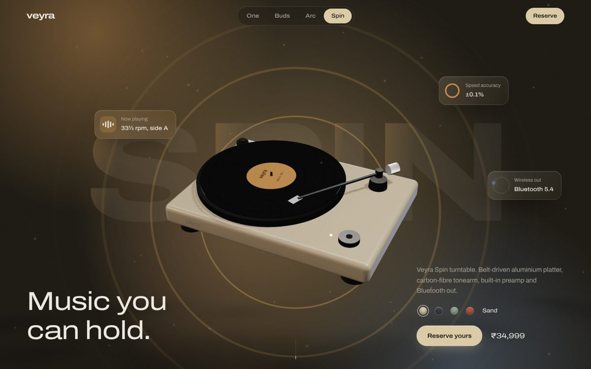 |

---

## Highlights

- **Five product pages, one engine.** Each product is a single config entry (copy, specs, 3D poses, labels). A product switcher with a curtain transition moves between them.
- **Procedural 3D models.** The headphones, earbuds, speakers and turntable are built from code (lathe, extrude and torus geometry), with no model files to download.
- **Scroll-driven camera choreography.** Each section has its own pose, and the model blends smoothly between them as you scroll.
- **Exploded views.** The headphones come apart, the earbud case opens and the buds rise out, the speaker's knit parts to show its drivers, Halo's fabric splits around its tweeters and woofer, and the turntable's record and platter lift off the belt drive. Labels track each part in 3D.
- **Listening demos.** A busy street and music are generated live in the browser. On One and Buds, switching noise cancelling on filters the street out. On Arc, bass boost lifts the low end. On Halo, room fill adds a real convolution reverb. On Spin, vinyl warmth adds analogue softness and surface crackle. Each has a real-time waveform and meter.
- **Finish picker that relights the page.** Sand, Graphite, Sage and Ember each recolour the product, the background, the moving colour light and the particles. Your choice carries across products.
- **Drag to turn.** Spin the headphones with your mouse or finger. They keep some momentum, then glide back.
- **Cinematic hero.** A loading intro, a spin-in entrance, a word-by-word headline, floating glass info cards with live meters, and sound-wave rings.
- **Realistic rendering.** Soft shadows, studio light panels, physically based materials (clearcoat, sheen, anisotropy) and procedural bump textures.
- **Fast on weaker laptops.** Resolution adjusts automatically to keep the frame rate smooth on integrated graphics.
- **Accessible.** Keyboard focus styles, ARIA roles for switches and swatches, and a calmer version for people who turn on "reduce motion".

| Headphones apart | Earbud case open |
|---|---|
| 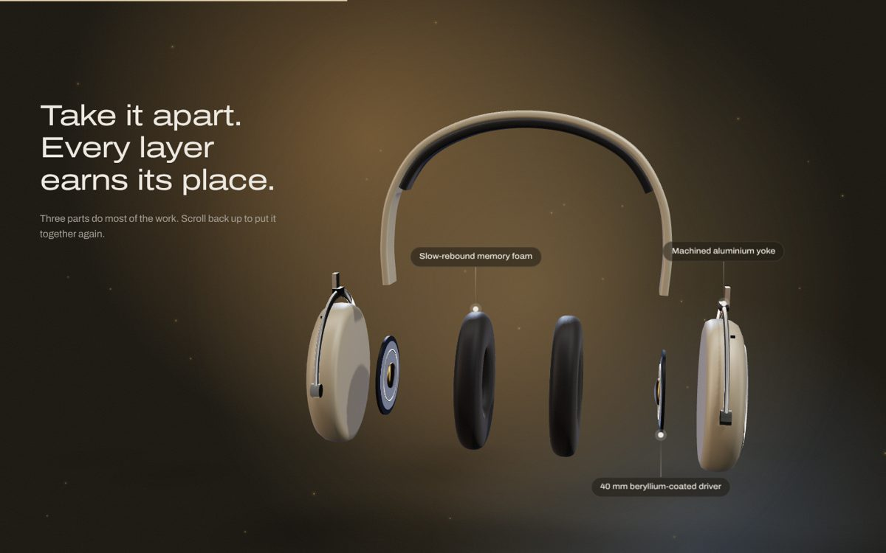 | 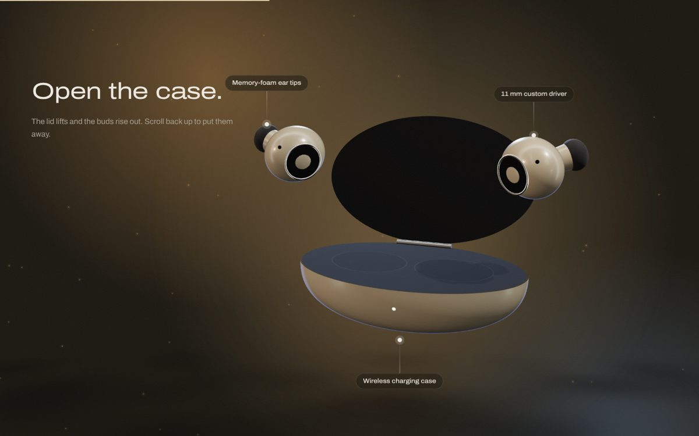 |

| Speaker apart | Halo apart |
|---|---|
| 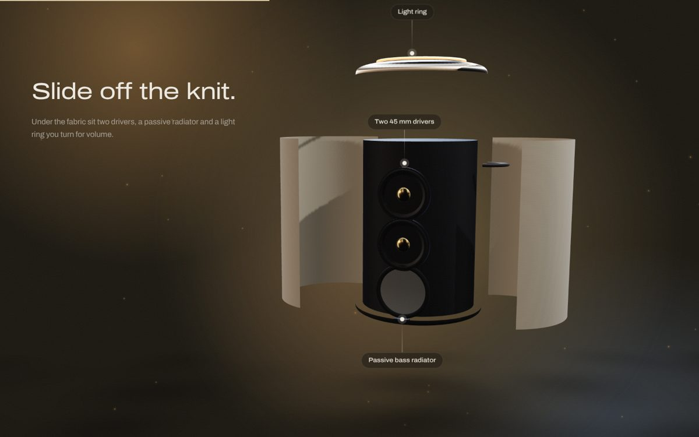 | 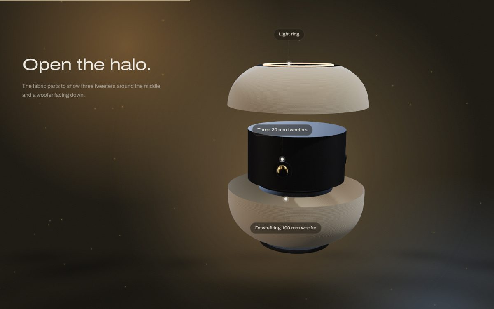 |

| Turntable apart | Listening demo |
|---|---|
| 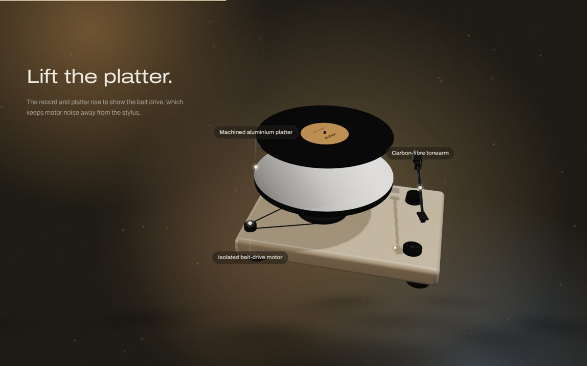 | 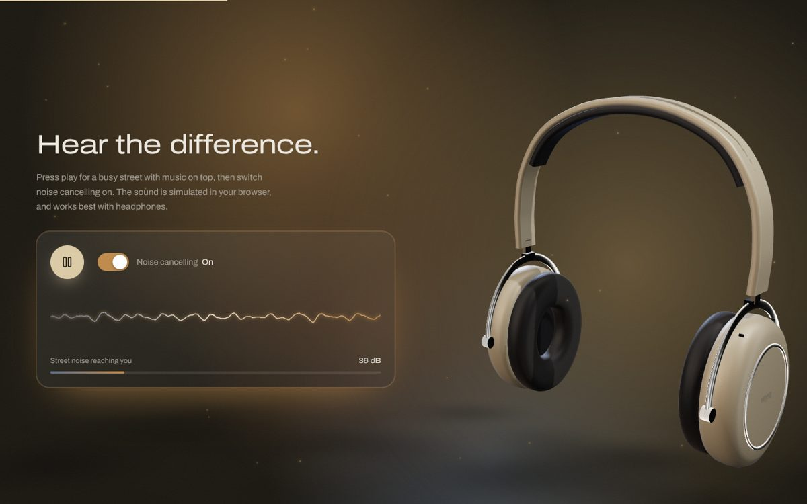 |

| Finishes | Mobile |
|---|---|
| 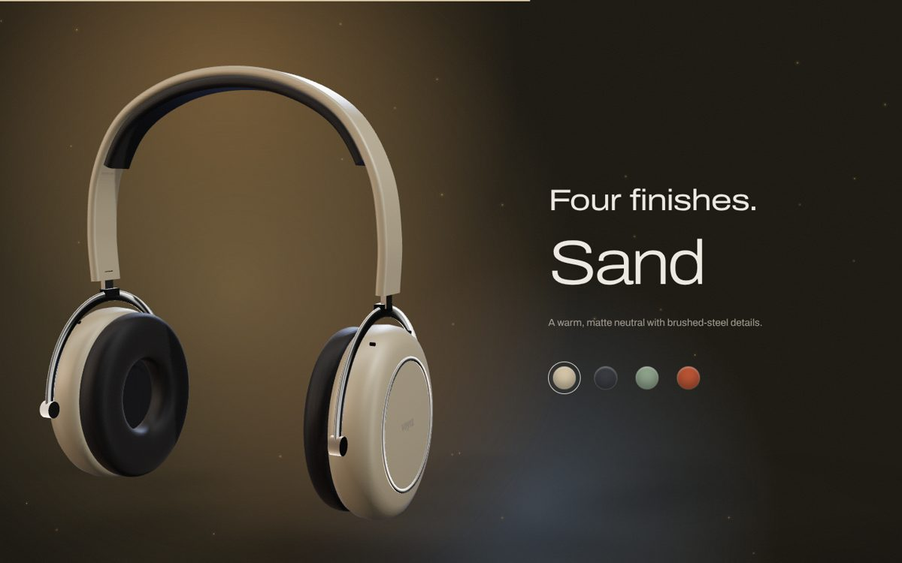 | 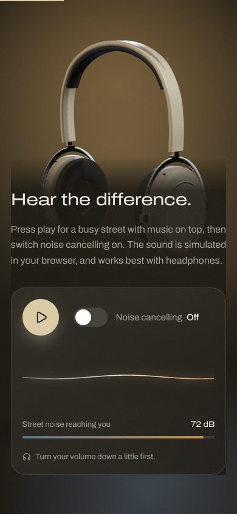 |

---

## Tech stack

| Area | Tools |
|---|---|
| Framework | React 19, Vite, React Router |
| 3D | Three.js, React Three Fiber, drei |
| Animation | Motion (Framer Motion), Lenis smooth scrolling |
| Audio | Web Audio API (no audio files) |
| Styling | Plain CSS with design tokens (CSS variables) |
| Type and icons | Archivo variable font (self-hosted), lucide-react |
| Hosting | Vercel |

---

## Getting started

You need [Node.js](https://nodejs.org) 20.19 or newer (or 22.12+).

```bash
git clone https://github.com/Adityak0012/veyra-3d.git
cd veyra-3d
npm install
npm run dev
```

Open http://localhost:5173.

| Command | What it does |
|---|---|
| `npm run dev` | Starts the dev server with hot reload |
| `npm run build` | Builds the production site into `dist/` |
| `npm run preview` | Serves the production build locally |
| `npm run lint` | Checks the code with oxlint |

---

## Project structure

```
veyra-3d/
├── public/                    # favicon and share image (og.jpg)
├── docs/                      # screenshots for this README
├── src/
│   ├── components/
│   │   ├── models/
│   │   │   ├── Headphones.jsx # Veyra One
│   │   │   ├── Buds.jsx       # Veyra Buds: case, lid hinge, earbuds
│   │   │   ├── Arc.jsx        # Veyra Arc: knit body, drivers, light ring
│   │   │   ├── Halo.jsx       # Veyra Halo: fabric dome, glass top, tweeters, woofer
│   │   │   ├── Spin.jsx       # Veyra Spin: plinth, spinning record, tonearm, belt drive
│   │   │   └── shared.js      # procedural texture helpers
│   │   ├── ProductPage.jsx    # all page sections, driven by a product config
│   │   ├── Scene.jsx          # canvas, lighting, scroll poses, sound rings, labels
│   │   └── Listen.jsx         # listening demo UI
│   ├── App.jsx                # routing, product switcher, curtain transition, loader, footer
│   ├── products.js            # the five products: copy, specs, FAQ, 3D poses, and the finishes
│   ├── audio.js               # Web Audio engine: noise cancelling, bass boost, room fill, vinyl warmth
│   ├── interaction.js         # shared state (drag-to-turn, intro timing, smooth scroll)
│   ├── index.css              # design tokens and all styles
│   └── main.jsx
├── vercel.json                # sends /buds and /arc to the app on Vercel
└── index.html
```

**Adding another product:** build a model in `src/components/models/` (it receives `color`, `explodeRef` and `anchors`), then add an entry to `PRODUCTS` in `products.js`. The page, menu tab and footer link appear automatically.

---

## How it works

**Scroll poses.** Every `<section data-stage>` has a matching entry in that product's `poses` array in `products.js` (position, rotation, scale and how far apart the parts are). Each frame, the scene finds the two sections nearest the middle of the screen and blends between their poses. Phone poses are derived from these automatically.

**Labels on the 3D model.** Empty anchor points are placed on the model. Each frame their positions are projected to the screen, and the HTML labels are moved to match.

**Finishes.** Each finish in `data.js` sets the shell colour plus the page's background (`bg`), the glow behind the product (`glow`) and three `aura` colours. CSS transitions make the whole page shift light smoothly.

**Noise-cancelling demo.** `audio.js` builds a small audio graph:

- Brown noise for traffic rumble, filtered noise for wind, random car horns and a slow traffic swell.
- A chord pad with gentle plucked notes for the music.
- With noise cancelling on, only the street is filtered and turned down by about 36 dB. An analyser feeds the waveform and the meter.

---

## Deploying

1. Push the project to GitHub.
2. On [vercel.com](https://vercel.com), choose **Add New → Project**, import the repository and press **Deploy**. Vercel detects Vite automatically.
3. Put your live URL into the `og:image` tag in `index.html` (e.g. `https://veyra-3d.vercel.app/og.jpg`) so link previews show the image.

Every push to `main` redeploys automatically.

---

## Ideas for next steps

- Swap in a real `.glb` model (`npx gltfjsx model.glb` turns it into a React component).
- Connect the reserve form to a backend such as Formspree or Supabase.
- Add a cart and checkout flow, or a light "studio white" theme.

---

## Author

**Aditya Kale**

- GitHub: [@Adityak0012](https://github.com/Adityak0012)
- LinkedIn: [adityak0012](https://www.linkedin.com/in/adityak0012/)

If you like this project, a star on GitHub is appreciated.
